<p align="center">
  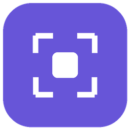
</p>

<h1 align="center">Snap Desk</h1>

<p align="center">
  A free, open-source, cross-platform screenshot and screen recording app for Windows, macOS (Apple silicon), and Linux.<br />
  Screenshots, scrolling capture, annotation, pinning, recording, OCR, translation, and clipboard history in one app.
</p>

<p align="center">
  <a href="https://github.com/bitdan/snap-desk/releases">Download</a> ·
  <a href="https://bitdan.github.io/snap-desk/en/">Website</a> ·
  <a href="#features">Features</a> ·
  <a href="#quick-start">Quick Start</a> ·
  <a href="TECHNICAL.md">Technical Guide (Chinese)</a> ·
  <a href="Snap_Desk_TODO.md">Roadmap (Chinese)</a> ·
  <a href="docs/performance/README.md">Performance test (Chinese)</a>
</p>

<p align="center"><a href="README.md">简体中文</a> · English</p>

<p align="center">
  <a href="https://github.com/bitdan/snap-desk/releases/latest"></a>
  <a href="https://github.com/bitdan/snap-desk/releases"></a>
  
  
  <a href="LICENSE"></a>
</p>

| Light theme | Dark theme |
| :---: | :---: |
| 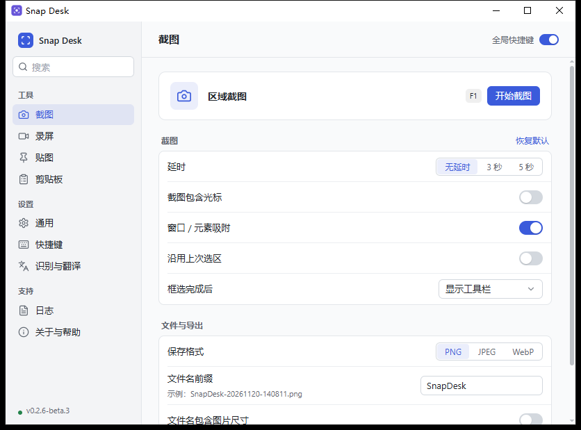 | 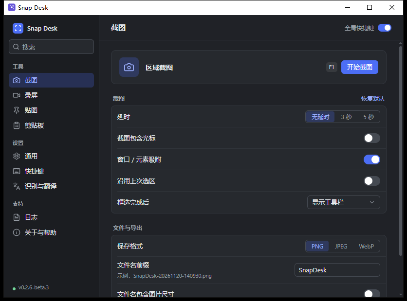 |

Screenshots show the Simplified Chinese interface; the app also ships an English UI.

## Performance

Native Rust, no embedded browser engine. Measured on a release build; full data in the [performance test](docs/performance/README.md) (Chinese).

<p align="center">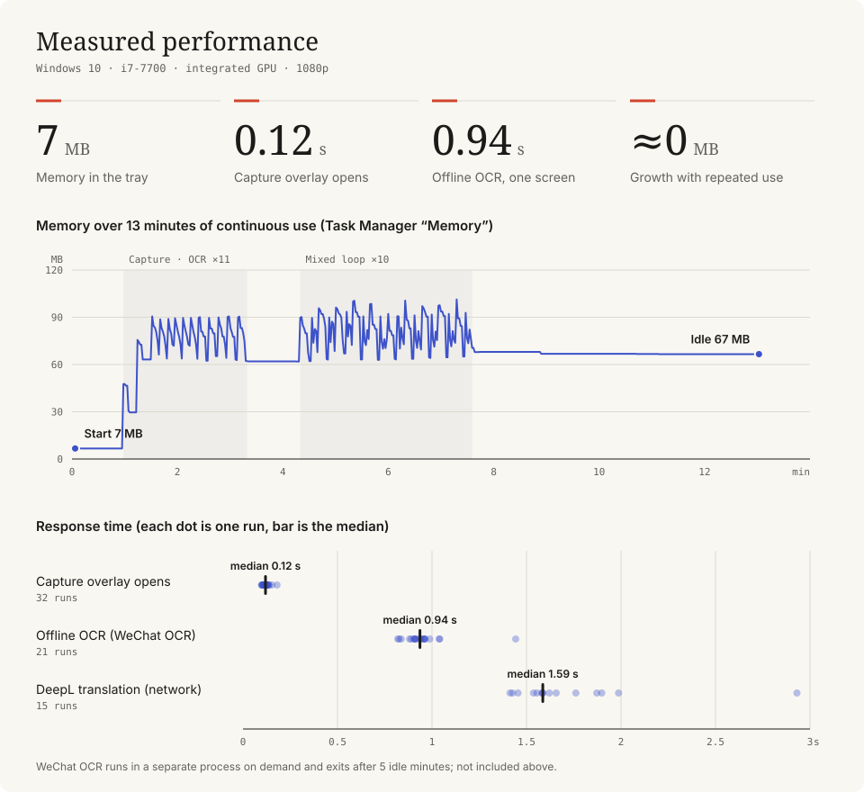</p>

## Features

✅ Supported. Capture, recording, pinning, and the clipboard all run on your computer; images or text are sent to a provider only when you choose an online service. See the [roadmap](Snap_Desk_TODO.md) for plans.

### Screenshot & Annotation

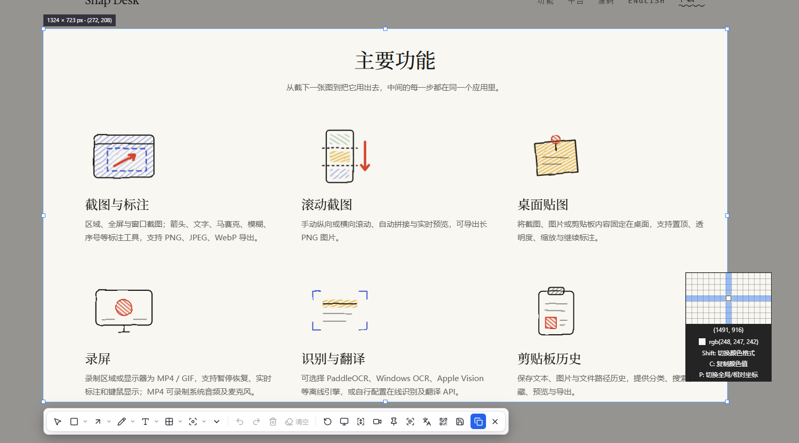

- ✅ Region and full-screen capture, snapping to windows and interface elements
- ✅ Multiple monitors, mixed scaling, capture delay, optional cursor
- ✅ Magnifier and color picker
- ✅ Reuse last selection; copy, pin, or save right after selecting
- ✅ Type the position and size (px / dp), lock an aspect ratio, size presets; move, grow, shrink, or resize the selection symmetrically with the arrow keys
- ✅ Capture history: replay the last 20 captures with `,` / `.` and keep editing
- ✅ 16 annotation tools: rectangle, ellipse, arrow, arrow with label, line, polyline, pen, highlighter, text, numbered label, spotlight, magnifier, mosaic, blur, pixel eraser, delete annotation
- ✅ Undo/redo, collapsible and reorderable toolbar
- ✅ PNG / JPEG / WebP / PDF export with custom filenames
- ✅ Quick save (Shift+click Save or Ctrl+Shift+S), auto-save with scheduled cleanup

### Scrolling Screenshot

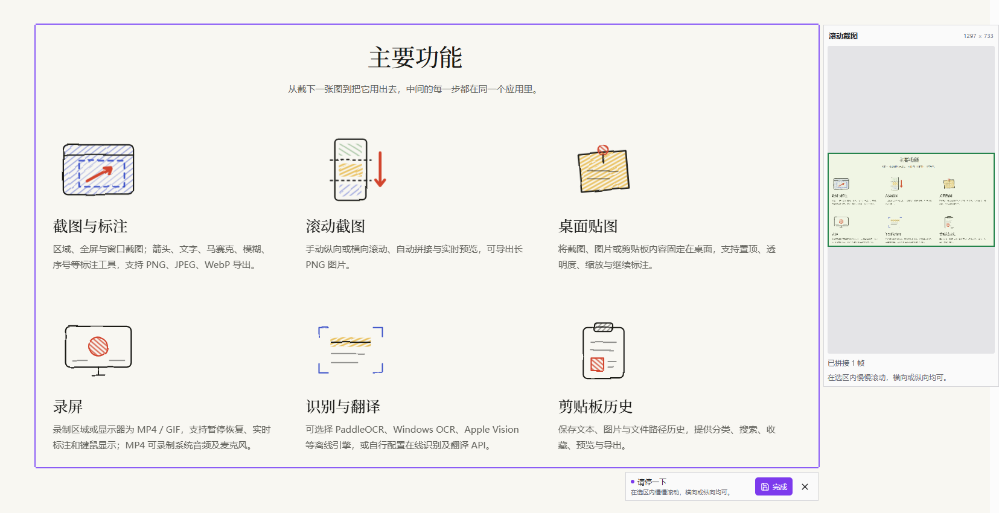

- ✅ Vertical or horizontal scrolling: the first scroll inside the selection sets the direction; scroll horizontally with a touchpad or tilt wheel, or hold Shift while scrolling
- ✅ Automatic stitching, with back-and-forth scrolling along the same axis; press Ctrl+C or the screenshot shortcut again to finish, Esc to cancel
- ✅ Live preview and failure recovery
- ✅ PNG export with a white or transparent background
- ✅ Afterwards, crop both ends, then copy, save, pin, or recognize text

### Screen Recording

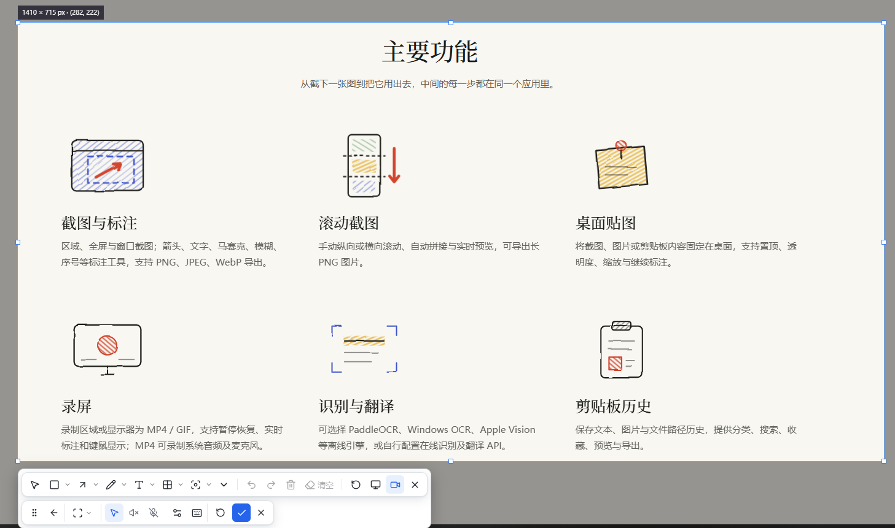

- ✅ Region or full-display recording, MP4 / GIF
- ✅ System audio, microphone, mouse pointer
- ✅ Countdown, pause/resume
- ✅ Live annotation that fades out or is cleared by hand
- ✅ Input effects: key hints, click rings, pointer trails, drag paths, scroll hints
- ✅ Adjustable frame rate, quality, bitrate, and encoder

### Image Pinning

| Pinned image | Toolbar |
| :---: | :---: |
| 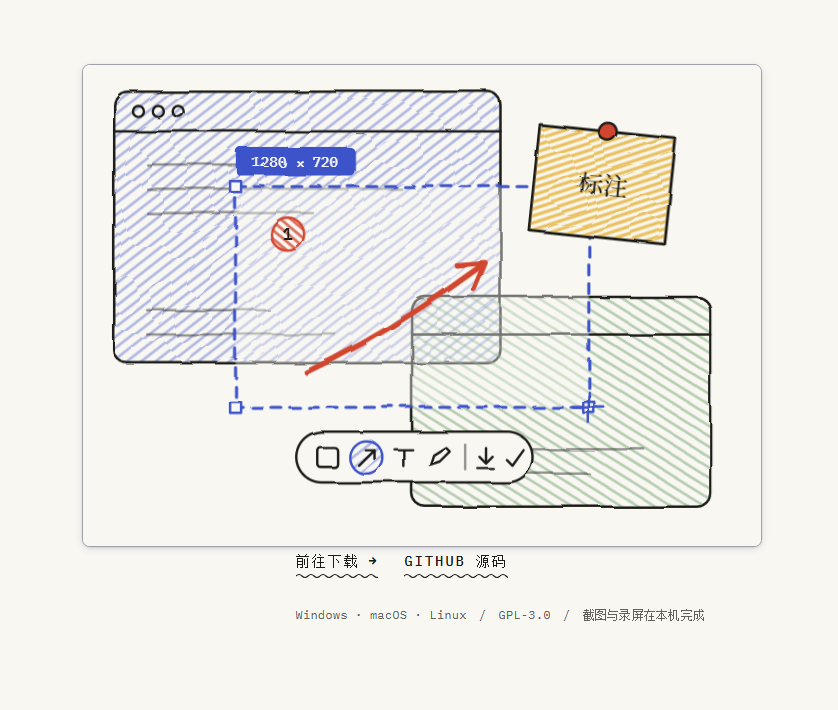 | 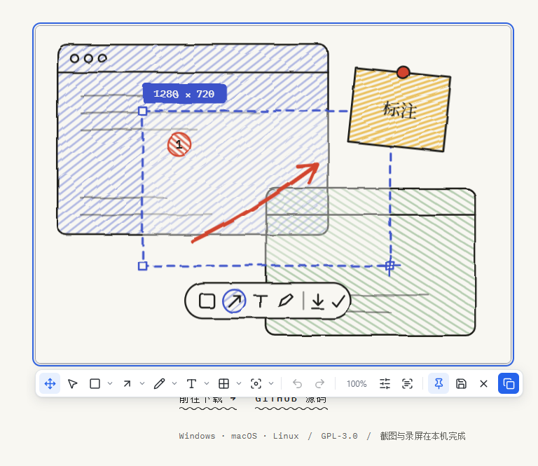 |

- ✅ Pin captures, image files, or clipboard text / rich text / colors
- ✅ Always on top, zoom, opacity, lock, click-through
- ✅ Groups and shared appearance (shadow, corner radius, border)
- ✅ Rotate, flip, grayscale, invert, auto adjust
- ✅ Annotate, copy, save, drag out to other apps
- ✅ OCR, QR code recognition, image translation

### Top Shelf

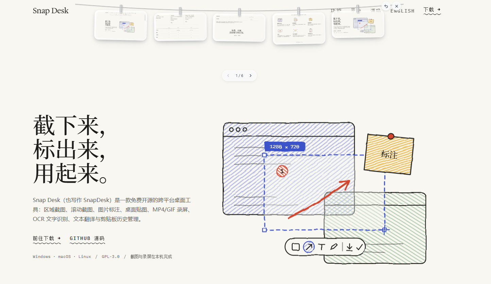

- ✅ Opens with a shortcut or when the pointer rests at the top center of the screen
- ✅ Holds chosen categories: text, images, files, links, paths, colors, favorites
- ✅ Click to copy, drag to share, take down as a pinned image
- ✅ Undoable removal that leaves clipboard history untouched

### Clipboard History

| History window | Combined export |
| :---: | :---: |
| 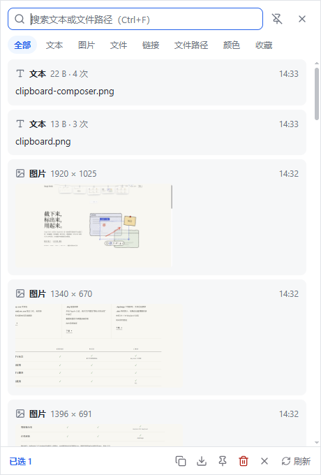 | 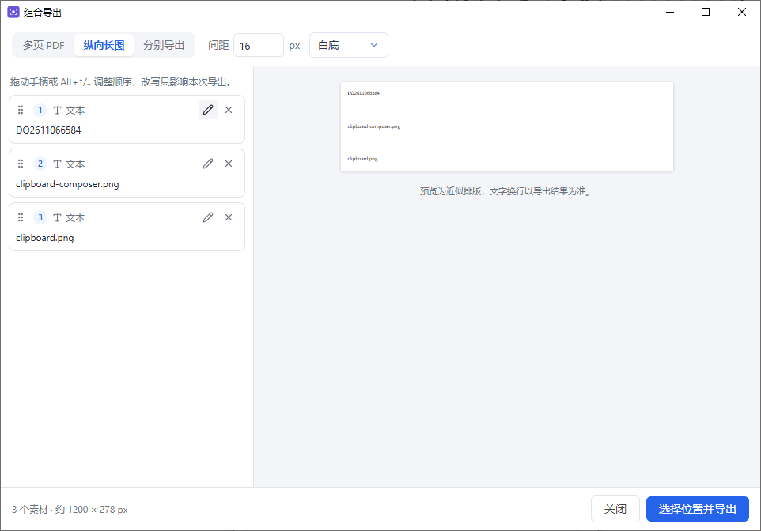 |

- ✅ Text, image, and file-path history
- ✅ Categories, search, favorites, previews
- ✅ Enter pastes into the previous window, `Ctrl+1`–`9` quick pick, multi-select batch actions
- ✅ Combined export to PDF / long image / separate files, with reordering and text rewriting
- ✅ Retention days, item count, and size limits

### OCR & QR Codes

| OCR result | QR code |
| :---: | :---: |
| 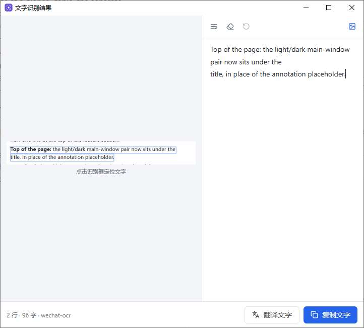 | 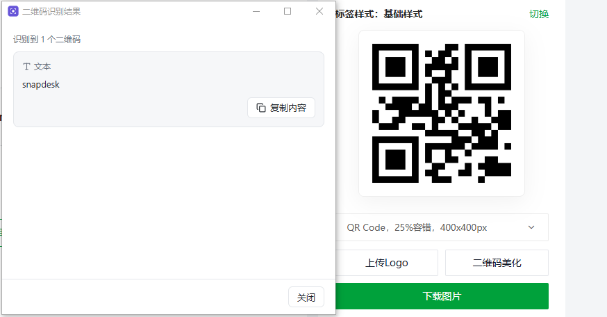 |

- ✅ Offline: PaddleOCR PP-OCRv6, Windows OCR, Apple Vision, WeChat OCR (experimental)
- ✅ Online: OCR.space, Paddle API, Groq Vision, DeepSeek, custom vision services
- ✅ Shortcut-driven recognition, with recognition boxes over the original image
- ✅ Merge line breaks, tidy spaces, auto copy
- ✅ Local QR code recognition, with confirmation before opening links

### Translation

| Translate after OCR | Translation window |
| :---: | :---: |
| 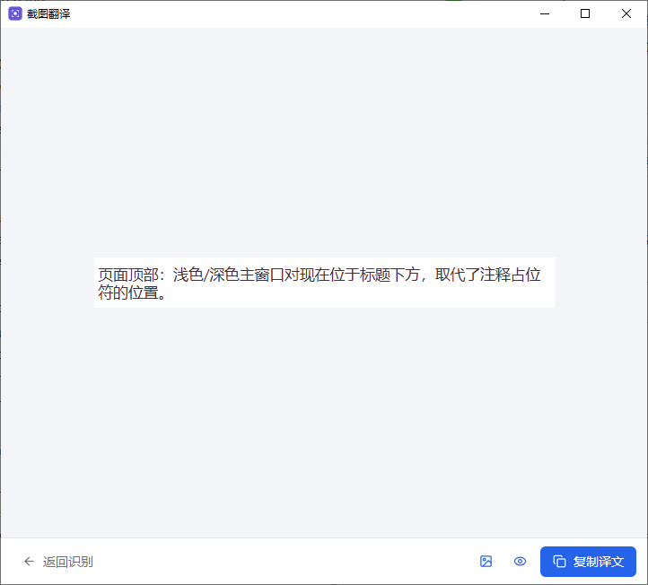 | 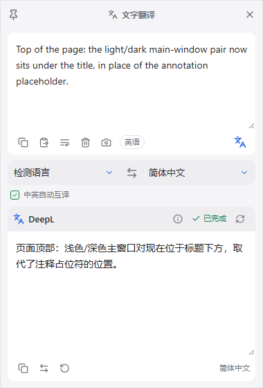 |

- ✅ Offline: CTranslate2 Chinese–English
- ✅ Online: DeepL, Groq, DeepSeek, OpenAI, custom text services
- ✅ Local: Ollama and other compatible services
- ✅ Selected-text, screenshot, and pinned-image translation, plus a standalone window
- ✅ Automatic Chinese ↔ English, plus Japanese, Korean, French, German
- ✅ Translate back, swap languages, keep on top

### AI & Service Management

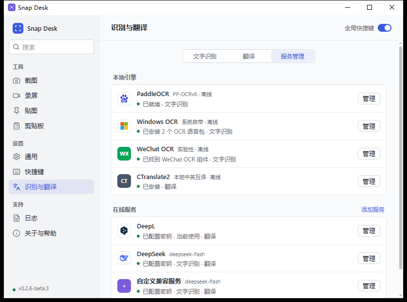

- ✅ Multiple account/model connections, several keys each tested individually
- ✅ DeepSeek, Groq, OCR.space, PaddleOCR, DeepL presets, plus Chat Completions–compatible services
- ✅ Keys stored in Windows Credential Manager / macOS Keychain / Linux Secret Service
- ✅ Local models and language packs installed on demand, verified, unloaded when idle

### Updates & Settings

| Shortcuts | App updates |
| :---: | :---: |
| 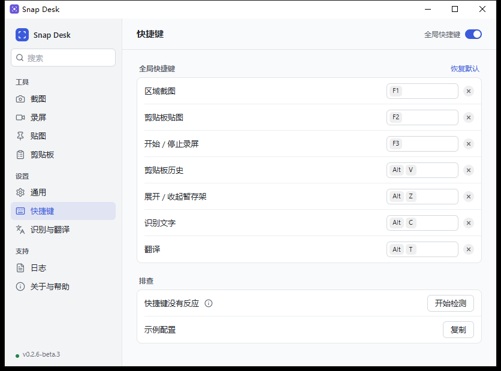 | 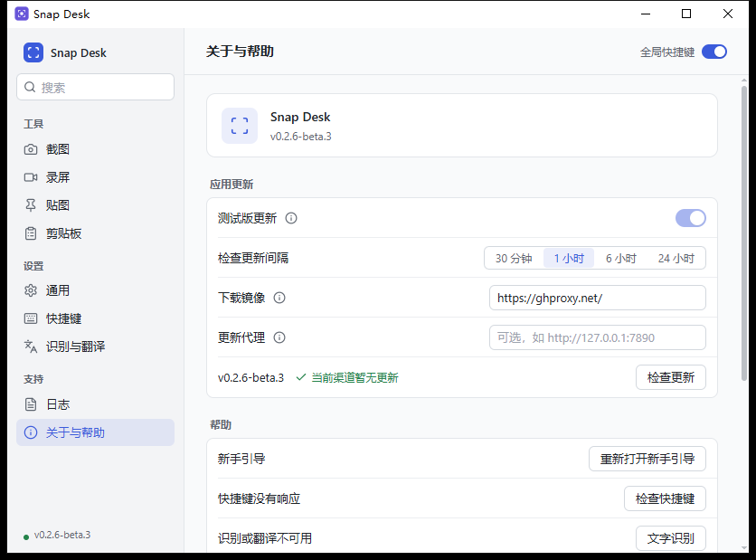 |

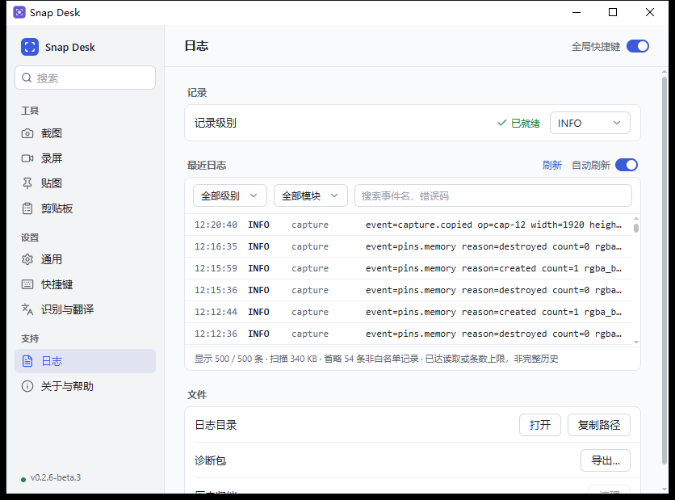

- ✅ Stable / beta online updates with signature verification
- ✅ Download mirror, update proxy, check interval
- ✅ Custom shortcuts, conflict detection, command-line actions
- ✅ Tray icon, launch at login
- ✅ Chinese / English UI, light / dark theme, onboarding guide
- ✅ Settings import / export
- ✅ Log filters and diagnostics export

## Download

Download from [Releases](https://github.com/bitdan/snap-desk/releases).

| Platform | File | Status |
| --- | --- | --- |
| Windows x64 | `-setup.exe` installer / `-standalone.exe` standalone EXE | Full feature set |
| macOS Apple silicon | `-macos-arm64.dmg` | Full feature set, macOS 13.3+ |
| Linux x64 | `-linux-x64.AppImage` / `-linux-x64.deb` | Preview, glibc 2.35+ (Ubuntu 22.04 era) |

<details>
<summary><strong>macOS and Linux notes</strong></summary>
<br />

- **macOS**: tested on an Apple silicon Mac, with the same features as the Windows version. Not notarized by Apple: on first launch, allow it in System Settings → Privacy & Security, then allow Snap Desk under Privacy & Security → Screen & System Audio Recording (called Screen Recording on macOS 14 and earlier). The app is signed with a fixed certificate, so updates keep the permission. Offline text recognition uses the built-in Apple Vision; PaddleOCR, WeChat OCR, and the offline translation engine are Windows-only, so use an online service instead.
- The Linux build has only passed CI builds and automated tests and has not been tested on real hardware; please open an issue if something does not work.
- **Linux**: the AppImage (about 100 MB) bundles its dependencies and updates online; the deb (about 20 MB) is upgraded by installing the new package. On Wayland, capture is single-display, recording goes through the ScreenCast portal, pause/resume, input effects, and live annotation are X11-only, clipboard history and selected-text translation go through Xwayland, and direct paste falls back to copy only.

</details>

## Quick Start

1. Press `F1` to capture, drag a region, then annotate, copy, or save. Screenshots need no setup.
2. Pick OCR and translation engines under Recognition & Translation: install resources for offline engines, or enter your own API key for online services.
3. Default shortcuts: `F1` capture · `F2` pin · `F3` record · `Alt+V` clipboard · `Alt+T` translate · `Alt+Z` shelf · `Alt+C` OCR (letter keys use `Ctrl+Alt` on macOS).
4. If global shortcuts cannot be registered (for example on Wayland), bind a system shortcut to `snap-desk --action capture`; other actions are `pin`, `record`, `history`, `translate`, `shelf`, and `ocr`.

For development, builds, and service integrations, see the [technical guide (Chinese)](TECHNICAL.md).

## FAQ

**Do OCR and translation work offline?** Yes. PaddleOCR, Windows OCR, Apple Vision, and WeChat OCR recognize text locally; CTranslate2 translates Chinese–English offline.

**Is it free?** Yes, free and open source (GPL-3.0-only). Third-party online services may charge.

**A shortcut does nothing?** Check whether it is marked in use on the Shortcuts page and run the shortcut test; meanwhile use the tray menu or a command-line action.

**Black screenshots or “no permission” when recording on macOS?** macOS ties the Screen & System Audio Recording grant to the app's signature, so a build with a different signature invalidates the old grant even though the switch still looks on. Clear Snap Desk's old grants in Terminal, quit and reopen Snap Desk, allow access when prompted on the next capture, then restart the app once more:

```bash
tccutil reset All io.snapdesk.app
```

You can also remove Snap Desk manually under System Settings → Privacy & Security → Screen & System Audio Recording with the “−” button. The command also clears Accessibility and Input Monitoring grants; allow them again when prompted.

## Feedback

Use the [issue forms](https://github.com/bitdan/snap-desk/issues/new/choose); Chinese and English are welcome. Include the version, OS, and steps to reproduce, and remove secrets and personal data before sharing screenshots, logs, or diagnostics bundles.

## Acknowledgements

- [Tendedero](https://github.com/alejandrobujan/tendedero) by Alejandro Buján: a reference for the top shelf's hanging cards, hover-to-reveal, click-to-copy, and drag-to-share interactions. Thanks for sharing the project as open source.
- [GPUI](https://www.gpui.rs/) (by Zed): the GPU-accelerated Rust UI framework the current version is built on; earlier versions were built on [Tauri](https://github.com/tauri-apps/tauri).
- [Pot](https://github.com/pot-app/pot-desktop): a reference for the translation and OCR modules. Thanks for sharing the project as open source.
- [wechat_ocr_sdk](https://github.com/MapleREHub/wechat_ocr_sdk): provides the Rust adapter for WeChat PC's built-in OCR engine.
- [LINUX DO](https://linux.do): a sincere, friendly and professional tech community; thanks to its members for trying Snap Desk and sending feedback.

## License

[GPL-3.0-only](LICENSE)
