<p align="center">
  
</p>

<h1 align="center">Snap Desk</h1>

<p align="center">
  免费开源的跨平台截图与录屏工具，支持 Windows、macOS（Apple 芯片）和 Linux。<br />
  截图、滚动截图、标注、贴图、录屏、OCR、翻译、剪贴板历史，一个应用完成。
</p>

<p align="center">
  <a href="https://bitdan.github.io/snap-desk/#download">下载</a> ·
  <a href="https://bitdan.github.io/snap-desk/">项目官网</a> ·
  <a href="https://bitdan.github.io/snap-desk/guide/">使用手册</a> ·
  <a href="#功能">功能</a> ·
  <a href="#开始使用">开始使用</a> ·
  <a href="TECHNICAL.md">技术说明</a> ·
  <a href="Snap_Desk_TODO.md">开发进度</a> ·
  <a href="docs/performance/README.md">性能测试</a>
</p>

<p align="center">简体中文 · <a href="README.en.md">English</a></p>

<p align="center">
  <a href="https://github.com/bitdan/snap-desk/releases/latest"></a>
  <a href="https://github.com/bitdan/snap-desk/releases"></a>
  
  
  <a href="LICENSE"></a>
</p>

| 浅色主题 | 深色主题 |
| :---: | :---: |
| 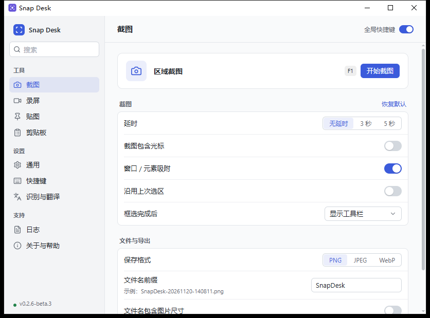 | 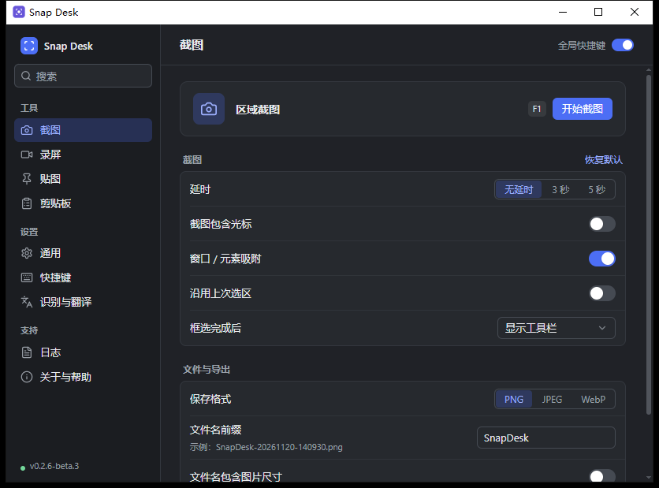 |

## 性能

Rust 原生实现，不内置浏览器内核。以下为 release 构建的实测数据，完整数据见 [性能测试](docs/performance/README.md)。

<p align="center">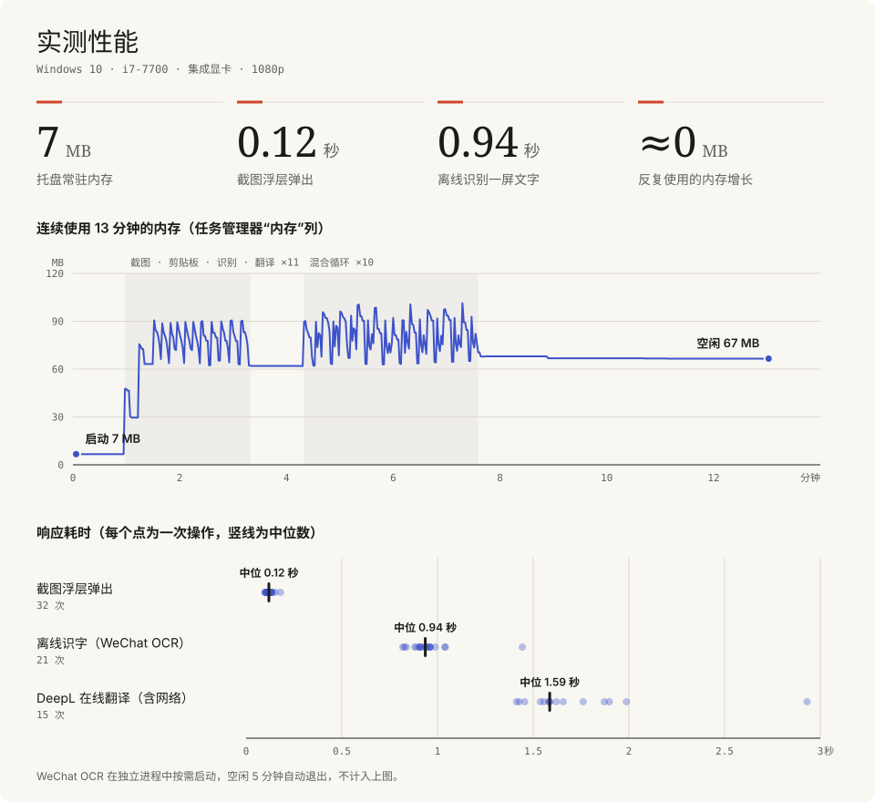</p>

## 功能

✅ 已支持。截图、录屏、贴图与剪贴板全部在本机完成；只有选择在线服务时，才会把图片或文字发给该服务商。后续计划见 [TODO](Snap_Desk_TODO.md)。

### 截图与标注

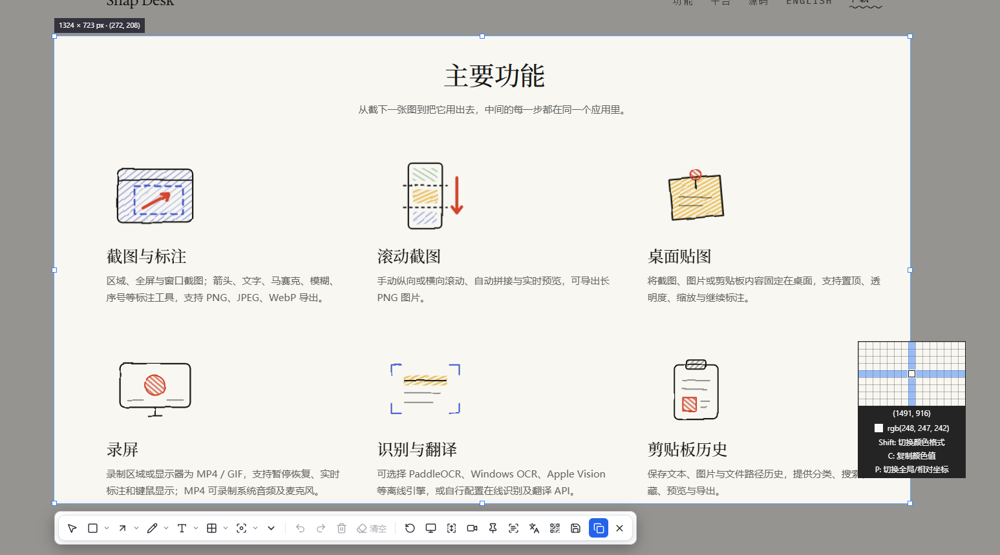

- ✅ 区域 / 全屏截图，窗口与界面元素吸附
- ✅ 多显示器、混合缩放、延时截图、包含光标
- ✅ 放大镜、取色器
- ✅ 沿用上次选区；框选后直接复制 / 贴图 / 保存
- ✅ 输入位置与尺寸（px / dp）、锁定比例、尺寸预设；方向键移动、扩展、收缩与对称缩放选区
- ✅ 截图历史：`,` / `.` 回放最近 20 次截图，继续编辑
- ✅ 16 种标注：矩形、椭圆、箭头、箭头文字、直线、折线、画笔、荧光笔、文字、序号、聚光灯、放大镜、马赛克、模糊、像素擦除、整项删除
- ✅ 撤销 / 重做，工具栏折叠与排序
- ✅ PNG / JPEG / WebP / PDF 导出，自定义文件名
- ✅ 快速保存（Shift+单击保存或 Ctrl+Shift+S），自动保存与定期清理

### 滚动截图

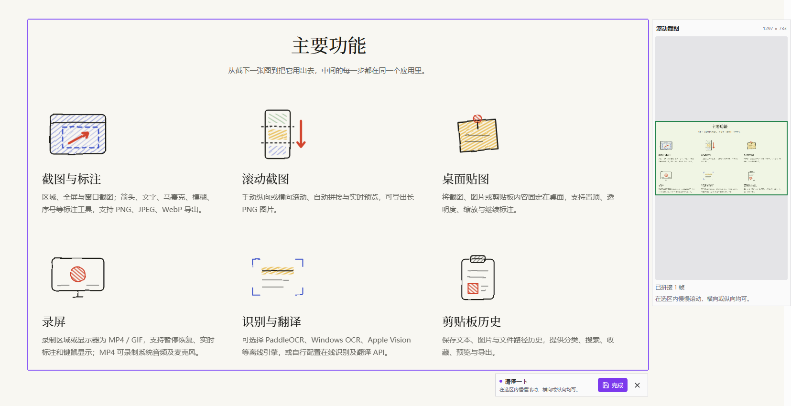

- ✅ 支持纵向或横向滚动：在选区内第一次滚动的方向决定拼接方向；横向用触控板 / 横向滚轮，或按住 Shift 滚动
- ✅ 自动拼接，可沿同一方向来回滚动；完成按 Ctrl+C 或再按截图键，Esc 取消
- ✅ 实时预览，失败恢复
- ✅ 白底 / 透明 PNG 导出
- ✅ 完成后裁掉两端，直接复制、保存、贴图或识别文字

### 录屏

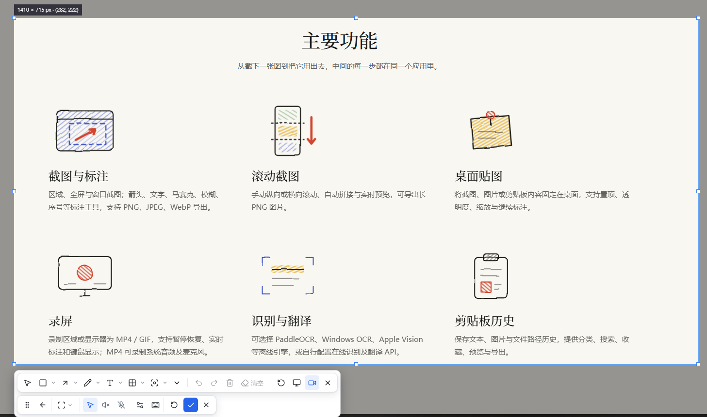

- ✅ 选区 / 整屏录制，MP4 / GIF
- ✅ 系统声音、麦克风、鼠标指针
- ✅ 倒计时、暂停 / 恢复
- ✅ 录制中标注，自动淡出或手动清除
- ✅ 键鼠特效：按键提示、点击光圈、移动尾迹、拖动轨迹、滚轮提示
- ✅ 帧率、画质、码率、编码方式可调

### 桌面贴图

| 贴图 | 工具栏 |
| :---: | :---: |
| 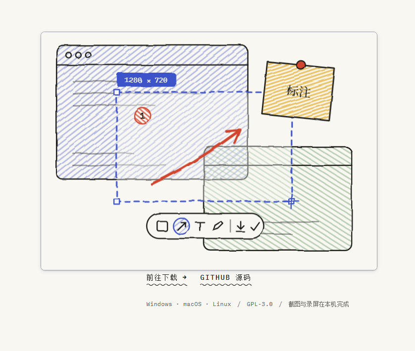 | 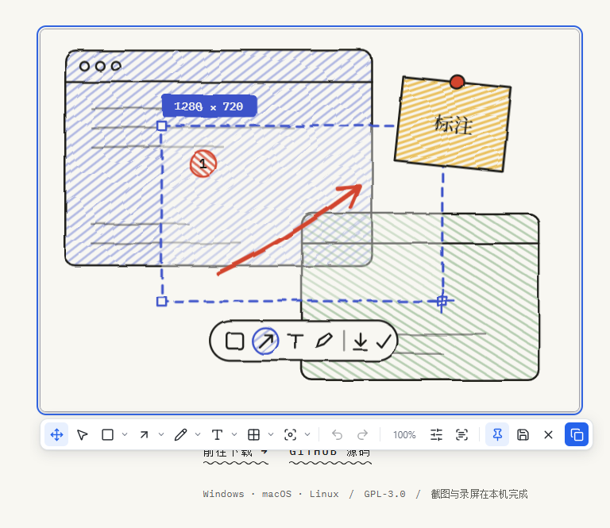 |

- ✅ 贴截图、图片文件、剪贴板文字 / 富文本 / 颜色
- ✅ 置顶、缩放、不透明度、锁定、鼠标穿透
- ✅ 分组管理，统一外观（阴影、圆角、边框）
- ✅ 旋转、翻转、灰度、反色、自动调整
- ✅ 继续标注、复制、保存、拖出到其他应用
- ✅ 文字识别、二维码 / 条形码识别、图片翻译

### 顶部暂存架

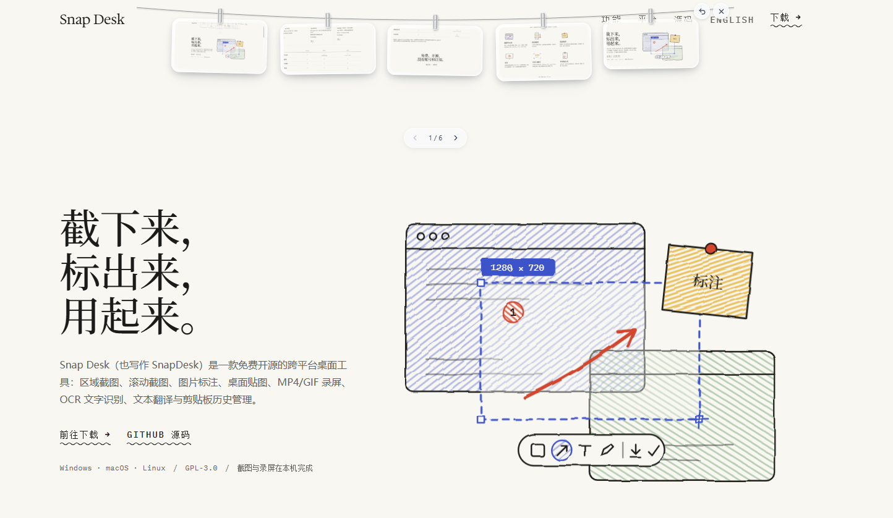

- ✅ 快捷键或鼠标停在屏幕顶部中央时展开
- ✅ 按类别放置：文本、图片、文件、链接、路径、颜色、收藏
- ✅ 单击复制、拖出分享、取下为贴图
- ✅ 移除可撤销，不影响剪贴板历史

### 剪贴板历史

| 历史窗口 | 组合导出 |
| :---: | :---: |
| 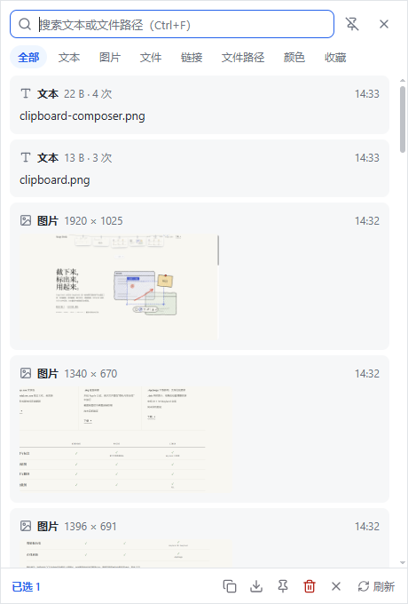 | 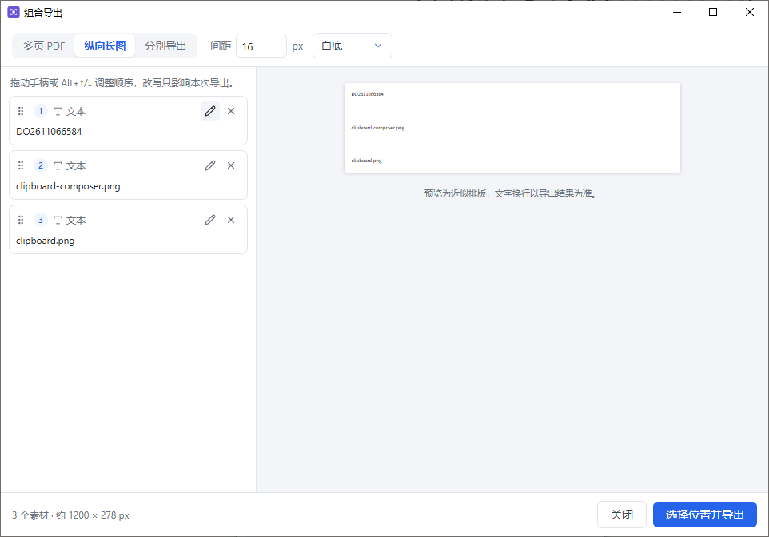 |

- ✅ 文本、图片、文件路径历史
- ✅ 分类、搜索、收藏、预览
- ✅ 回车粘贴到原窗口，`Ctrl+1`～`9` 快速选取，多选批量操作
- ✅ 组合导出 PDF / 长图 / 单独文件，可排序、改写文本
- ✅ 保留天数、条数与容量上限

### 文字识别、二维码与条形码

| 识别结果 | 二维码 |
| :---: | :---: |
| 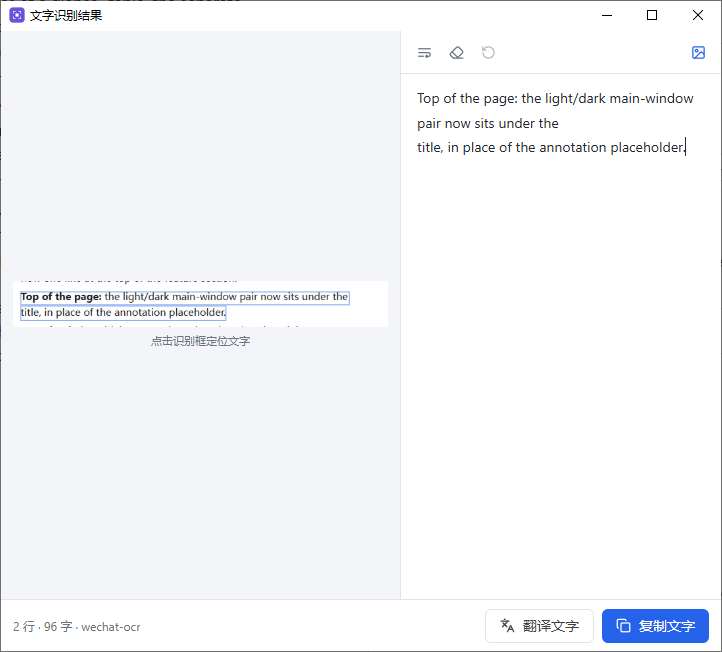 | 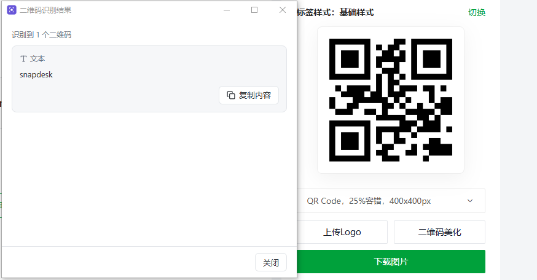 |

- ✅ 离线：PaddleOCR PP-OCRv6、Windows OCR、Apple Vision、WeChat OCR（实验性）
- ✅ 在线：OCR.space、Paddle API、Groq Vision、DeepSeek、自定义视觉服务
- ✅ 快捷键框选识别，识别框与原图对照
- ✅ 合并换行、整理空格、自动复制
- ✅ 本地识别二维码与条形码（Code 128、EAN、UPC 等），一图多码，打开链接前确认

### 翻译

| 识别后翻译 | 翻译窗口 |
| :---: | :---: |
| 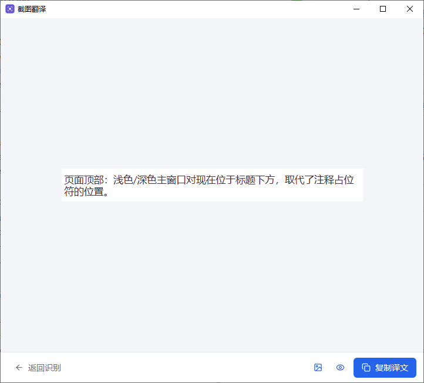 | 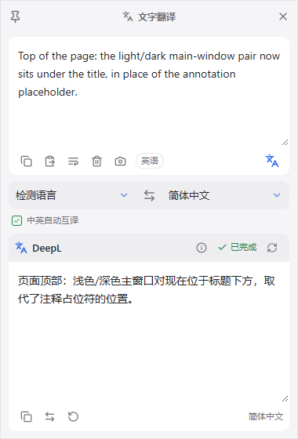 |

- ✅ 离线：CTranslate2 中英互译
- ✅ 在线：DeepL、Groq、DeepSeek、OpenAI、自定义文本服务
- ✅ 本机：Ollama 等兼容服务
- ✅ 划词翻译、截图翻译、贴图翻译、独立翻译窗口
- ✅ 中英自动互译，另支持日、韩、法、德
- ✅ 回译、交换语言、窗口置顶

### AI 与服务管理

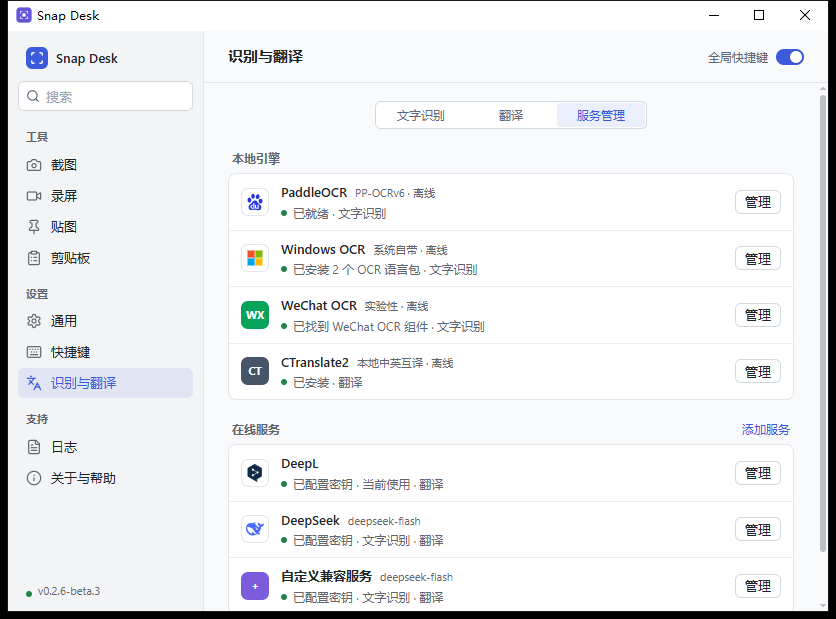

- ✅ 多账号 / 多模型连接，多密钥逐个测试
- ✅ 内置 DeepSeek、Groq、OCR.space、PaddleOCR、DeepL 预设，兼容 Chat Completions 接口
- ✅ 密钥存入 Windows 凭据库 / macOS 钥匙串 / Linux Secret Service
- ✅ 本地模型与语言包按需安装、校验、空闲回收

### 更新与设置

| 快捷键 | 应用更新 |
| :---: | :---: |
| 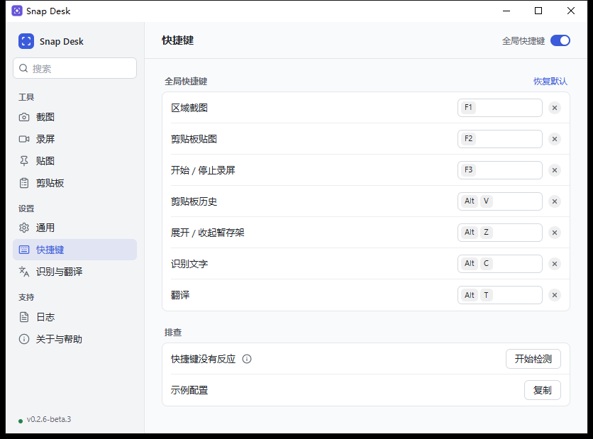 | 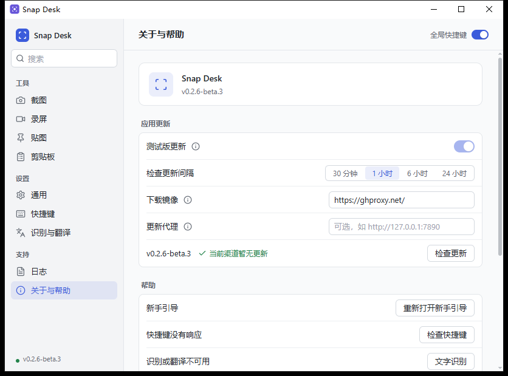 |

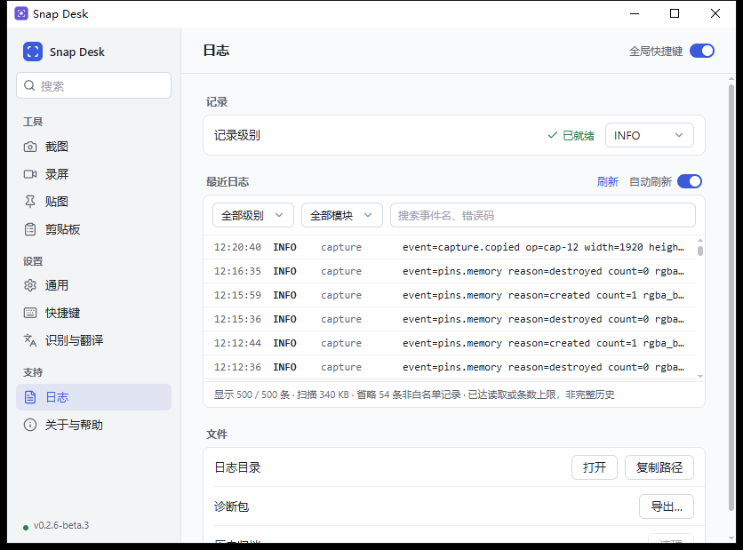

- ✅ 正式版 / 测试版在线更新，签名校验
- ✅ 下载镜像、更新代理、检查间隔
- ✅ 自定义快捷键、冲突检测、命令行动作
- ✅ 托盘常驻、开机自启
- ✅ 中英文界面、浅色 / 深色主题、新手引导
- ✅ 配置导入 / 导出
- ✅ 日志筛选、诊断包导出

## 下载

在[官网](https://bitdan.github.io/snap-desk/#download)直接下载对应安装包，或复制带 SHA-256 校验的终端命令。旧版和更新说明见 [GitHub Releases](https://github.com/bitdan/snap-desk/releases)。

- Windows x64（已安装 Scoop）：先运行 `scoop bucket add snap-desk https://github.com/bitdan/homebrew-snap-desk`，再运行 `scoop install snap-desk/snap-desk`。
- macOS Apple 芯片（已安装 Homebrew）：`brew install --cask bitdan/snap-desk/snap-desk`。
- Debian / Ubuntu：下载 deb 后，在文件所在目录运行 `sudo apt install ./<文件名>.deb`。AppImage 可用官网命令下载、校验并赋予执行权限。
- 其他渠道：[WinGet v0.3.2 正在审核](https://github.com/microsoft/winget-pkgs/pull/488147)，AUR 暂未上架。

| 平台 | 文件 | 状态 |
| --- | --- | --- |
| Windows x64 | `-setup.exe` 安装包 / `-standalone.exe` 独立 EXE | 功能完整 |
| macOS Apple 芯片 | `-macos-arm64.dmg` | 功能完整，需 macOS 13.3+ |
| Linux x64 | `-linux-x64.AppImage` / `-linux-x64.deb` | 预览，需 glibc 2.35+（Ubuntu 22.04 同期） |

<details>
<summary><strong>macOS 与 Linux 说明</strong></summary>
<br />

- **macOS**：已在 Apple 芯片 Mac 上实机验证，功能与 Windows 版一致。未经 Apple 公证，首次打开需在“系统设置 → 隐私与安全性”中放行，并在“隐私与安全性 → 录屏与系统录音”中允许 Snap Desk（macOS 14 及更早叫“屏幕录制”）；应用使用固定签名，更新后无需重新授权。离线文字识别使用系统自带的 Apple Vision；PaddleOCR、WeChat OCR 与离线翻译引擎仅限 Windows，可改用在线服务。
- Linux 版目前仅通过 CI 构建和自动化测试，尚未实机验证，遇到问题欢迎提交 Issue。
- **Linux**：AppImage 约 100 MB，自带依赖并支持在线更新；deb 约 20 MB，升级需覆盖安装。Wayland 下仅支持单显示器截图，录屏经屏幕共享门户，暂停 / 恢复、键鼠特效与录制中标注仅 X11 可用，剪贴板历史与划词翻译经 Xwayland，直接粘贴退化为只复制。

</details>

## 开始使用

1. 按 `F1` 截图，拖动选区后标注、复制或保存。只用截图无需任何配置。
2. 在“识别与翻译”中选择 OCR / 翻译引擎：离线引擎按提示安装资源，在线服务填写自己的 API Key。
3. 默认快捷键：`F1` 截图 · `F2` 贴图 · `F3` 录屏 · `Alt+V` 剪贴板 · `Alt+T` 翻译 · `Alt+Z` 暂存架 · `Alt+C` 识别（macOS 字母键为 `Ctrl+Alt`）。
4. 无法注册全局快捷键时（如 Wayland），可把系统快捷键绑定到 `snap-desk --action capture`，动作还有 `pin`、`record`、`history`、`translate`、`shelf`、`ocr`。

开发、构建与服务接入见 [技术说明](TECHNICAL.md)。

## 常见问题

**OCR 和翻译能离线吗？** 可以。PaddleOCR、Windows OCR、Apple Vision、WeChat OCR 本机识别，CTranslate2 离线中英互译。

**免费吗？** 免费开源（GPL-3.0-only）。第三方在线服务可能收费。

**快捷键没反应？** 在“快捷键”页查看是否被占用，并用“开始检测”排查；临时可用托盘菜单或命令行动作。

**macOS 截图黑屏、录屏提示没有权限？** 系统按应用签名记录“录屏与系统录音”授权，换了签名的新版本会让旧授权失效（开关仍显示开启）。在终端执行下面的命令清除 Snap Desk 的旧授权，然后退出并重新打开 Snap Desk，截图时按系统提示重新授权，再重启一次应用：

```bash
tccutil reset All io.snapdesk.app
```

也可以手动在“系统设置 → 隐私与安全性 → 录屏与系统录音”中选中 Snap Desk 点“−”移除。该命令同时清除辅助功能、输入监控等授权，用到时按提示重新允许即可。

## 反馈与建议

通过 [Issue 表单](https://github.com/bitdan/snap-desk/issues/new/choose) 反馈，支持中文和 English。请附上版本、系统和复现步骤；分享截图、日志或诊断包前请移除密钥和私人数据。

## 致谢

- [Tendedero](https://github.com/alejandrobujan/tendedero)（Alejandro Buján）：顶部暂存架的悬挂式卡片、悬停展开、点击复制与拖出分享等交互参考了该项目，感谢其开源分享。
- [GPUI](https://www.gpui.rs/)（Zed）：GPU 加速的 Rust 界面框架，当前版本基于它构建；早期版本基于 [Tauri](https://github.com/tauri-apps/tauri)。
- [Pot](https://github.com/pot-app/pot-desktop)：翻译与 OCR 模块参考了该项目，感谢其开源分享。
- [wechat_ocr_sdk](https://github.com/MapleREHub/wechat_ocr_sdk)：提供调用 WeChat PC 内置 OCR 引擎的 Rust 适配层。
- [LINUX DO](https://linux.do)：真诚、友善、团结、专业的技术社区，感谢佬友们的试用与反馈。

## 许可证

[GPL-3.0-only](LICENSE)
