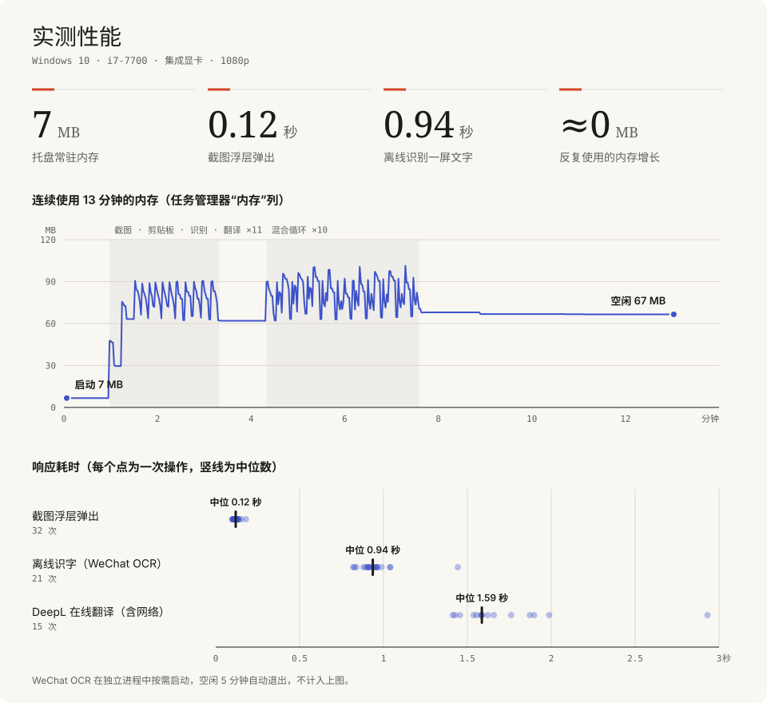

# 性能测试



- 环境：Windows 10 Pro 19045，i7-7700，32 GB 内存，Intel HD Graphics 630（集显），1920×1080 单屏 100% 缩放
- 构建：0.2.6-beta.3，`cargo build --release --locked -p snap-desk-gpui`
- 设置：OCR 为 WeChat OCR，翻译为 DeepL Free（目标简体中文，译文覆盖原图），截图后动作“无”
- 测试文本：14 行英文（Segoe UI 16pt），选区 1080×620
- 日期：2026-11-24
- 内存为真实占用，未做工作集修剪；“内存”列即任务管理器“内存”（专用工作集）

## 汇总

| 项目 | 结果 |
| --- | --- |
| 托盘常驻 | 内存 7 MiB，工作集 33 MiB，私有提交 14 MiB，10 线程 |
| 用过各功能后空闲 | 内存 62–68 MiB，私有提交约 86 MiB |
| 截图浮层弹出 | 中位数 119 ms，最大 180 ms（32 次） |
| WeChat OCR 识别 | 中位数 936 ms，首次 1,443 ms（21 次，每次 14/14 行） |
| DeepL 翻译（OCR 完成 → 译文覆盖完成） | 中位数 1,586 ms，最大 2,931 ms（15 次） |
| WeChat OCR 进程 `Weixin.exe` | 约 87 MiB，识别峰值约 200 MiB，空闲 5 分钟后退出 |
| 窗口开关 7 场景 × 8 次 | 私有增量 −1.5 ~ +0.8 MiB / 次，GDI 0，剩余窗口 0 |

## 各阶段内存（MiB，中位数 / 峰值）

| 阶段 | 内存 | 工作集 | 私有提交 | GPU 共享 | 子进程工作集 | 子进程私有 |
| --- | ---: | ---: | ---: | ---: | ---: | ---: |
| idle-start | 7 / 7 | 33 / 33 | 14 / 14 | 1 / 1 | — | — |
| capture-overlay | 47 / 48 | 91 / 92 | 105 / 116 | 50 / 50 | — | — |
| after-capture | 30 / 30 | 74 / 91 | 77 / 94 | 50 / 50 | — | — |
| clipboard-history | 74 / 76 | 137 / 139 | 107 / 122 | 34 / 34 | — | — |
| after-history | 63 / 63 | 128 / 137 | 83 / 94 | 34 / 34 | — | — |
| ocr-wechat-cold | 80 / 91 | 148 / 155 | 143 / 163 | 29 / 51 | 85 / 85 | 88 / 88 |
| ocr-wechat-warm | 80 / 90 | 153 / 163 | 144 / 162 | 29 / 51 | 86 / 198 | 89 / 201 |
| translate-deepl | 80 / 91 | 156 / 167 | 112 / 163 | 34 / 51 | 85 / 151 | 87 / 154 |
| idle-after-recognize | 62 / 62 | 139 / 139 | 86 / 86 | 34 / 34 | 85 / 85 | 87 / 87 |
| leak-cycle ×10 | 82 / 101 | 159 / 177 | 133 / 176 | 35 / 65 | 85 / 147 | 87 / 150 |
| idle-after-cycles | 68 / 71 | 138 / 141 | 88 / 90 | 35 / 35 | 87 / 87 | 90 / 90 |
| idle-wechat-release | 67 / 68 | 137 / 138 | 86 / 88 | 9 / 35 | 87 / 87 | 90 / 90 |
| idle-released | 67 / 67 | 137 / 137 | 86 / 86 | 9 / 9 | 0 | 0 |

## 耗时（ms）

| 项目 | 次数 | 首次 | 中位数 | 最大 |
| --- | ---: | ---: | ---: | ---: |
| 截图浮层弹出（`gpui.action` → `gpui.overlay_shown`） | 32 | 180 | 119 | 180 |
| WeChat OCR 识别（引擎自报 `duration_ms`） | 21 | 1,443 | 936 | 1,443 |
| DeepL 翻译（`gpui.ocr_finished` → `gpui.translation_finished`） | 15 | 1,537 | 1,586 | 2,931 |

## 窗口开关（每场景 8 次，增量取第 3 次起平均）

| 场景 | 内存 | 私有提交 | 私有 / 次 | 句柄 / 次 | GDI / 次 | 剩余窗口 |
| --- | ---: | ---: | ---: | ---: | ---: | ---: |
| 截图框选后取消 | 59.5 | 114.2 | −0.6 | −0.7 | 0 | 0 |
| OCR 识别窗口 | 58.6 | 82.2 | 0.0 | −0.3 | 0 | 0 |
| 文字翻译窗口 | 56.5 | 75.2 | 0.0 | 0.0 | 0 | 0 |
| 剪贴板历史 | 67.1 | 87.9 | 0.0 | +0.7 | 0 | 0 |
| 剪贴板贴图 | 65.2 | 92.0 | 0.0 | +0.5 | 0 | 0 |
| 截图后贴图 | 81.5 | 111.6 | +0.8 | 0.0 | 0 | 0 |
| 暂存架展开 / 收起 | 71.7 | 90.8 | −1.5 | 0.0 | 0 | 0 |

## 复现

运行时会重启 Snap Desk 并模拟键鼠，期间勿操作电脑、勿锁屏。在 PowerShell 中直接调用（不要用 `pwsh -File`）。

```powershell
./docs/performance/run-scenarios.ps1 -Calibrate
```

```powershell
./docs/performance/run-scenarios.ps1 -TranslateButton 1101,776
```

```powershell
./docs/performance/summarize.ps1 -RunDir ./docs/performance/results/<时间戳>
```

```powershell
./docs/performance/chart.ps1 -RunDir ./docs/performance/results/<时间戳>
```

```powershell
./docs/performance/window-probe.ps1
```

| 脚本 | 作用 |
| --- | --- |
| `run-scenarios.ps1` | 完整场景（约 17 分钟），`-Calibrate` 只截图用于确定“截图翻译”按钮坐标 |
| `sampler.ps1` | 约 1.4 秒采样一次主进程与子进程内存、CPU、句柄、GPU |
| `text-target.ps1` | 显示固定的测试文本 |
| `summarize.ps1` | 生成各阶段内存与耗时表 |
| `chart.ps1` | 生成 `docs/assets/performance.svg` 与 `performance.en.svg` |
| `window-probe.ps1` | 窗口开关探针（约 6 分钟，会改写剪贴板） |
| `memory-map.ps1` | 进程内存按私有 / 映像 / 映射分类 |

原始数据：`results/20261124-100557/`（`samples.csv`、`app.log`、`run.json`），`results/probe-20261124-101907/`（`points.csv`、`summary.csv`）。
