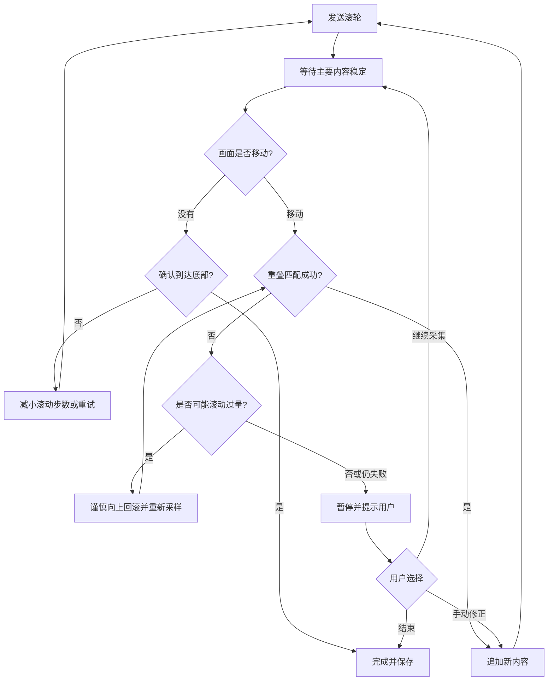

# 跨平台截图工具开发 TODO

Tauri 2 + Vue 3 + TypeScript + Rust 桌面截图工具，面向 Windows / macOS / Linux。

- `[x]` 表示代码已接入，不代表原生编译或实机验收完成；验收项单独记录。
- 同一任务只在所属功能下维护，不追加版本进度、增量记录或重复清单。
- 使用和构建说明见 [README](README.md)，协作与验证规则见 [AGENTS.md](AGENTS.md)。

## 0. 项目基础（P0）

- [x] Tauri 2 + Vue 3 + Rust 工程、主界面、设置、关于和快捷键页面。
- [x] 系统托盘、单实例运行，关闭主窗口收起到托盘。
- [x] JSON 配置持久化、旧字段默认兼容、损坏配置提示与保存失败回滚。
- [x] 基础运行日志、命令错误提示与初始化失败重试。
- [ ] 开机自启。
- [ ] 日志管理与应用级异常恢复。

## 1. 基础截图（P0）

- [x] 主屏区域 / 全屏截图，框选、移动、八方向缩放、取消。
- [x] 截图全局快捷键（默认 F1）、自定义 / 恢复默认及注册冲突处理。
- [x] 立即 / 3 秒 / 5 秒延时截图，倒计时取消。
- [x] 8 倍像素放大镜、十字准星、原图坐标及尺寸显示。
- [x] 方向键按像素微调选区，Shift 加速、Alt 调整宽高。
- [x] 复制剪贴板、图片保存、截图转贴图；取消或导出失败保留编辑现场。
- [x] 最近成功导出的选区记忆与 R 恢复，DPI 换算及分辨率检查。
- [ ] 原生窗口截图、窗口 / 元素识别与选区吸附。
- [ ] 多显示器、跨屏框选及混合 DPI 适配。
- [ ] 截图光标显示 / 隐藏开关。

## 2. 图片标注（P0 → P1）

- [x] 矩形、椭圆、直线、折线、箭头、画笔、荧光笔和文字。
- [x] 序号标注、矩形聚光灯、2～4 倍放大镜。
- [x] 区域马赛克 / 模糊、局部像素橡皮擦及整项删除。
- [x] 颜色、线宽、透明度、字号与字体配置。
- [x] 对象选择、移动、缩放、二次编辑、撤销 / 重做、删除 / 清空。
- [x] 截图与贴图共用编辑器，预览与导出合成同步。
- [ ] 自动马赛克 / 智能擦除。
- [ ] 独立图片裁剪、水印；旋转 / 翻转已由贴图功能提供。

## 3. 贴图功能（P1）

- [x] 截图、剪贴板、文本便签、颜色及 PNG / JPEG / WebP 文件贴图。
- [x] 文件透明度与 EXIF 方向处理，动画 WebP 使用首帧。
- [x] 独立多窗口、置顶、拖动、10%～400% 缩放、底部工具栏与焦点边框。
- [x] Windows / Linux 显示透明度、窗口锁定、隐藏、分组及批量管理。
- [x] 继续标注、复制、保存，截图转贴图保留可编辑标注。
- [x] 图片旋转、翻转、灰度、反色及恢复原图。
- [ ] macOS 透明贴图窗口。

## 4. OCR 与智能工具（P1 → P2）

- [x] 主屏静态截图取色，HEX / RGB 预览与复制、方向键微调。
- [ ] 本地中英文 OCR，贴图文字选取 / 复制。
- [ ] 二维码与链接识别。
- [ ] 图片 / 文本翻译。
- [ ] 数学公式识别与 LaTeX 导出（可选）。

## 5. 录屏与长截图

### 5.1 录屏架构

视频及输入事件留在 Rust；Vue 只配置和展示状态。保留现有 `start_recording`、`control_recording`、`current_recording` 命令，由 `recorder/manager.rs` 管理生命周期；配置、平台能力、帧所有权和时间轴使用强类型契约。

Windows 无声视频与键鼠合成代码已接入，音频分支为后续方案，不要求同时输出两份 MP4。不引入 FFmpeg；平台暂不支持的能力明确返回错误，不生成占位成功结果。

### 5.2 录屏 TODO

#### 基础能力

- [x] Windows 主屏区域 / 全屏无声 MP4，30 / 60 FPS、光标开关和平台能力查询。
- [x] 待开始、立即 / 3 秒 / 5 秒倒计时、暂停 / 恢复、停止 / 取消；托盘、控制条、快捷键共用会话，拒绝过期命令。
- [x] QPC 时间轴扣除暂停时长，按代次淘汰旧帧，静态画面延长上一帧显示时间。
- [x] 两帧有界编码队列、停止后排空与封装，完成同步后才发布 MP4，正常取消 / 失败清理临时目录。
- [x] 自定义保存目录、跨重启记忆、恢复默认及写权限检查。
- [x] 常驻细边框与控制条、捕获排除、屏幕边缘避让及控制页加载失败恢复。
- [x] 删除未接入的旧 PNG 离线录屏模块，保留截图 / 长截图的 PNG 能力。

#### P0 · 性能与稳定性

- [x] BGRA 直接转 NV12，复用转换缓冲，按 2×2 块读取并处理奇数尺寸补边。
- [x] 按分辨率、FPS 和节省空间 / 均衡 / 高清档位计算目标码率，替换固定 8 Mbps。
- [x] Media Foundation 硬件优先、准备阶段软件回退，展示实际编码类型与失败原因；无法识别时保留未知状态。
- [x] WGC 帧事件唤醒替代 4ms 固定轮询，保留超时检查停止和设备状态。
- [x] 展示时长、提交帧数、队列 / 代次丢帧、平均有效 FPS、编码提交耗时和目标码率。
- [ ] 测量并减少采集 / 编码拷贝，评估缓冲池和 SIMD，保证异步内存所有权正确。
- [x] 区分采集、帧率节流、队列满 / 旧代次丢弃与编码提交统计，增加近两秒 FPS 和采集 / 合成 / 编码提交耗时；暂停恢复重置窗口，静态画面自然降为零。
- [ ] 在测试配置下完成至少 10 分钟及更长资源压力测试，稳定后取消 3 分钟限制。
- [ ] 异常退出后的临时会话识别、恢复与清理，避免删除活动会话或已发布视频。

#### P0 · 键鼠操作可视化

- [x] 隐藏 HWND、RIDEV_INPUTSINK、WM_INPUT 独立消息线程；失败提示、设备注销及线程 / 窗口释放。
- [x] 强类型、有界事件缓冲；合并高频移动 / 滚轮，生产端维护按键与按钮状态，避免释放事件丢失后卡住。
- [x] Raw Input 与 WGC 使用同源 QPC；复用暂停代次，清除旧事件及跨暂停按住状态。
- [x] Ctrl+C、Alt+Tab、Enter、Esc 等白名单快捷键 / 功能键，左右修饰键及自动重复处理。
- [x] 左键 / 右键 / 双击不同颜色的扩散光圈，双击使用系统时间和位置阈值。
- [x] GetCursorPos 物理坐标映射、移动尾迹、拖动轨迹及选区外裁剪。
- [x] 上下滚轮方向提示，合并累计量并保留方向变化。
- [x] Rust 在 BGRA → NV12 前绘制特效，按媒体时间播放并写入最终 MP4。
- [x] 静态画面复用干净底图重绘动画，结束补干净帧；恢复时重建 WGC 获取新底图。
- [x] 默认关闭监听，不显示普通文字；暂停、结束、取消和失败清空监听及事件缓冲。
- [x] 键盘 / 点击 / 移动 / 拖动 / 滚轮独立开关，颜色、尺寸、持续时间和按键位置配置，兼容旧调用。

#### P1 · 功能完善

- [ ] WASAPI Loopback 系统音频与麦克风：AudioFrame 契约、重采样 / 混音、AAC 编码及 QPC 音视频同步封装。
- [ ] 多显示器与窗口来源选择，处理负坐标、混合 DPI、来源关闭和尺寸变化。
- [x] 自定义目标码率（1–80 Mbps、小数输入、前后端校验），留空恢复按画质自动计算，兼容旧调用。
- [ ] 优化文件命名、完成后预览、打开目录和简单裁剪。
- [ ] 录制标注、摄像头画中画。

#### P2 · 长期扩展

- [ ] D3D11 GPU BGRA → NV12 与纹理直接编码，扩展 CPU / GPU 帧载体、步长及所有权契约。
- [ ] macOS：ScreenCaptureKit + VideoToolbox，适配输入事件与权限。
- [ ] Linux：PipeWire / XDG Desktop Portal，确定编码运行库与桌面环境输入能力。
- [ ] H.265、GIF、WebP 动图及更多质量预设。
- [ ] HDR 色彩映射。

#### 录屏验收

- [ ] 状态：待开始 / 倒计时取消、快速暂停恢复、重复停止、旧会话命令、零帧与编码失败；视频时长扣除暂停。
- [ ] 界面：控制条可操作、四边保持细线、全屏 / 贴边 / DPI 避让、选区穿透、Alt+F4 保护；辅助窗口不录入且结束后释放。
- [ ] 输出：1080p / 4K、30 / 60 FPS、三档画质、奇数选区、颜色与方向、静态 / 动态画面播放及拖动定位。
- [ ] 编码：自动 / 软件模式、驱动失败回退、实际类型识别、设备丢失、磁盘满及目录失效；失败不发布损坏文件。
- [ ] 输入：白名单快捷键与普通中英文输入、AltGr、长按、双击、高频滚轮、拖动出入选区；无误显示、跨界连线或遗留监听。
- [ ] 合成：静态画面动画完整播放并消失，暂停恢复不重放；队列拥堵后仍清除最后一帧特效。
- [ ] 资源：连续启停、队列拥堵、空闲 CPU、停止响应及回调释放；长录制压力任务见本节 P0。

### 5.3 长截图 TODO

#### 基础能力

- [x] 主屏区域纵向自动 / 手动滚动，行投票 + SAD + NCC 匹配及稳定性检查。
- [x] 按实际位移调整滚轮步长，连续无位移停止；匹配失败同位置重试 2 次后输出已确认部分。
- [x] 选区边框、实时缩略预览与定位框、结束 / 取消；结束自动保存 PNG 并复制。
- [x] 可选原始 PNG 帧及操作日志存档，限制会话磁盘用量。
- [x] 有界原尺寸导出：64 帧、60000 行，成图与源帧缓存各最多 3200 万像素。

#### P0 · 可诊断与失败恢复

- [ ] 补齐采集 / 稳定 / 匹配 / 重试 / 结束状态日志，记录耗时、位移、置信度和分类失败原因；不依赖开启原始帧存档。
- [ ] 匹配重试失败后暂停并允许继续、保存或取消，保留已确认结果及重叠基准，不再直接结束。
- [ ] 识别并排除固定页头 / 页脚、悬浮元素和局部动态区域，明确成图保留规则，避免重复或误裁正文。
- [ ] 按区域改进稳定性检测，容忍局部 GIF / 视频 / 光标，整体仍滚动时继续等待。
- [ ] 分类处理低纹理、重复图案和无重叠，提供恢复提示；置信度不足时暂停，防止误拼接。

#### P1 · 性能与交互

- [ ] 粗到细重叠搜索，缓存上一帧特征并处理重复图案歧义。
- [ ] 核对 xcap 平台能力后改为区域采集，保持物理坐标与辅助窗口避让一致。
- [ ] 原始帧异步存档：有界队列、独立写入线程、帧 / 日志编号一致，处理拥堵、满盘和退出排空。
- [ ] 鼠标移动后暂停而不是结束，重新定位后允许继续。
- [ ] 人工重叠预览与接缝修正，确认后更新基准并继续滚动。
- [ ] 原始帧存档的应用内恢复与清理入口。

#### P2 · 扩展

- [ ] 窗口滚动容器识别、特定浏览器网页截图模式，明确权限及支持范围。
- [ ] 横向与双向拼接。
- [ ] 超长截图的磁盘分块缓存与流式导出。

#### 长截图验收

- [ ] 网页 / 编辑器 / 文件列表，固定元素、局部动画、懒加载、低纹理、重复列表、无重叠及页面到底；成图无重复、漏行或错误接缝。
- [ ] 暂停 / 继续、人工修正、结束 / 取消、旧会话请求及预览一致性；对应新功能实现后验收。
- [ ] 比较采集、匹配、存档耗时与内存 / 磁盘用量，覆盖慢盘、满盘、队列拥堵和退出释放，既有容量限制继续生效。
- [ ] 保存 / 剪贴板分别失败或同时失败时保留可用结果，不误报成功；边框和预览避让、DPI、显示器变化及辅助窗口排除正确。

## 6. 使用体验与配置（P1 → P2）

- [x] 截图 / 贴图单排工具栏与右键工具选择。
- [x] PNG、JPEG（质量及白底合成）、无损 WebP 导出；文件名前缀、毫秒时间戳、可选尺寸及保存目录记忆。
- [ ] 其他全局快捷键与鼠标动作自定义。
- [ ] 工具栏自由浮动、自定义工具顺序。
- [ ] 截图历史列表与图片管理。
- [ ] 普通截图自动保存、自定义目录与更多命名模板。
- [ ] 深色 / 浅色主题、多语言、隐私权限引导。
- [ ] 启动速度、截图响应和内存占用优化。

## 7. 跨平台与统一验收

- [ ] Windows / macOS / Linux X11 的截图、快捷键、贴图、剪贴板、透明度与置顶行为；录屏和长截图用例只在第 5 节维护。
- [ ] Linux Wayland Portal 截图及权限交互，按桌面环境说明能力差异。
- [ ] 多屏、混合 DPI、屏幕四角与窗口边界；选区预览、最近选区恢复和导出像素一致。
- [ ] 标注编辑 / 撤销 / 导出一致性：中文输入法、荧光笔重叠、聚光灯、放大镜、像素擦除及旋转后的坐标和透明度。
- [ ] 文件贴图 EXIF、透明 WebP / 首帧、损坏 / 超限输入及取消后的窗口恢复。
- [ ] 快捷键冲突、延时取消、配置升级 / 损坏 / 写入失败、目录记忆、格式扩展名及覆盖确认。
- [ ] Windows 安装 / 卸载 / 升级与 macOS / Linux 构建；发布标识、签名、公证和自动更新。
- [ ] GitHub Actions CI、平台条件编译与定向自动化测试。

原生与实机验收尚未全部完成；历史测试批次不作为当前版本已通过的依据。默认只执行相关静态检查和定向测试，编译、打包与实机验证按协作规则执行。
